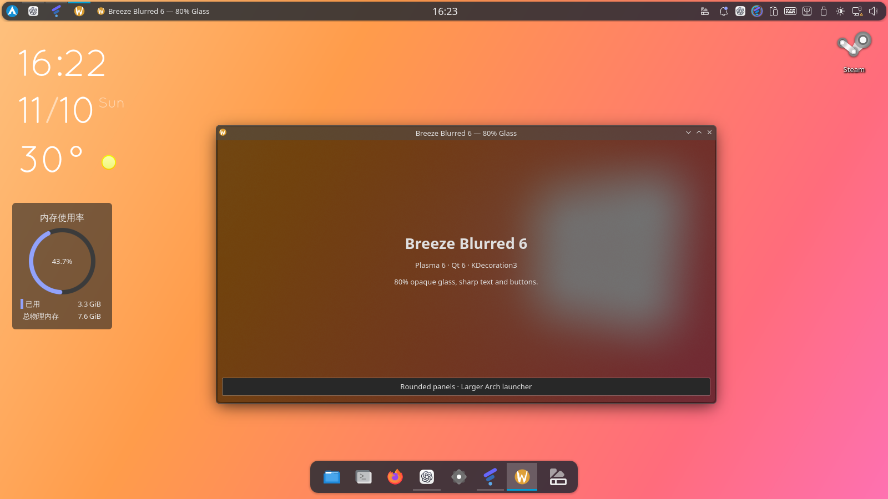
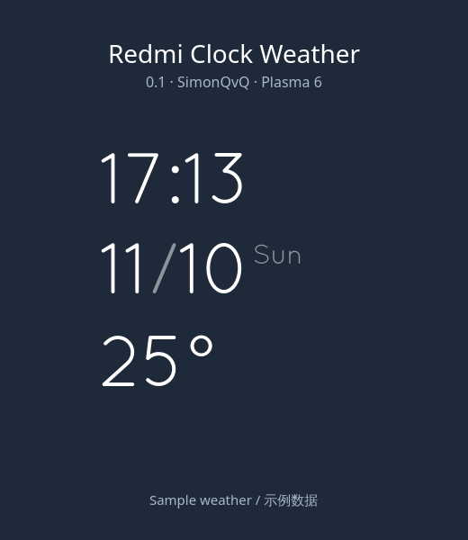

# vKDE

```text
          ██╗   ██╗██╗  ██╗██████╗ ███████╗
          ██║   ██║██║ ██╔╝██╔══██╗██╔════╝
          ██║   ██║█████╔╝ ██║  ██║█████╗
          ╚██╗ ██╔╝██╔═██╗ ██║  ██║██╔══╝
           ╚████╔╝ ██║  ██╗██████╔╝███████╗
            ╚═══╝  ╚═╝  ╚═╝╚═════╝ ╚══════╝
            very kool desktop environment
```

**SimonQvQ 的 KDE Plasma 6 桌面配置包 · v0.1**

深色主题、80% 不透明玻璃、圆角顶栏、底部居中 Dock、Fluent 图标，以及四种天气源的 Redmi Clock Weather。vKDE 是一套现有 KDE 桌面的配置，不是独立发行版。



上图是本机玻璃窗口和布局的实拍示例，截图来自早期 Arch 启动器版本；当前安装预设使用 Fluent 的 Windows 风格启动器。截图中的壁纸、Steam、ChatGPT 等应用不随安装包分发。壁纸保留你原来的选择。

## 安装

v0.1 自动安装面向 **Arch Linux、已有 KDE Plasma 6、Python 3.12 或更新版本**。请在 Plasma 桌面里的终端运行，使用普通用户。无需编译，无需注销或重启，应用布局时 Plasma Shell 会短暂重启。

```bash
git clone --depth 1 --branch v0.1 https://github.com/SimonQvQ/vKDE.git
cd vKDE
./install.sh --dry-run   # 查看将安装的内容，不修改设置
./install.sh             # 一键安装并应用
```

也可以从 [Releases](https://github.com/SimonQvQ/vKDE/releases) 下载 `vKDE-0.1.tar.gz`，解压后运行 `./install.sh`。安装脚本首先验证捆绑资源的 SHA-256，只通过 pacman 安装缺少的运行时依赖：`kvantum`、`python-dbus`、`python-gobject`、`qt6-tools`。基础 Plasma 组件须已安装。脚本不会进行系统升级，仓库不同步时请先自行更新系统。

`./install.sh --assets-only` 仅安装资源，保留当前布局和外观选项。默认安装会将现有面板替换为顶栏和 Dock，保留桌面原有小部件，补充天气时钟和原生内存监控。安装前自动备份所有将修改的资源和配置到 `$XDG_STATE_HOME/vkde/backup-*`（默认 `~/.local/state/vkde/`），失败会回退此次修改。

恢复安装前状态：

```bash
./install.sh --restore ~/.local/state/vkde/backup-实际时间与编号
```

使用安装结束时打印的实际路径。恢复会短暂重启 Plasma Shell；恢复整个备份的配置文件也会撤回你在安装后对这些文件的修改。请先保存后续需要保留的设置。运行时依赖及新安装的独立窗口装饰库会保留，恢复布局和原窗口装饰后它不再使用。

## 包含什么

| 部分 | 使用的组件 |
| --- | --- |
| 配色、Plasma、Qt 主题 | We10XOS-dark / We10XOSDark / Kvantum |
| 图标 | Fluent-dark，Windows 风格启动器 |
| 顶栏 | 启动器、运行软件、窗口列表、全局菜单、时钟、托盘 |
| Dock | 原生 Plasma 图标任务管理器，居中浮动、窗口躲避 |
| 面板外观 | Panel Colorizer 8.0.0，海军蓝、80% 不透明、圆角 14 |
| 桌面 | Redmi Clock Weather 0.1、Plasma 原生内存监控 |
| 窗口 | Breeze Blurred 6，符合二进制版本条件时启用 |
| Konsole | Author Glass，80% 不透明、模糊、深灰背景 |

只固定系统已经安装的 Dolphin、Konsole、Firefox；不会为 Dock 额外安装应用。新启动的 Qt 应用会采用新的主题，正在运行的应用可能需要关闭再打开。

显示分辨率、缩放、输入法、快捷键、登录界面和锁屏选项保持原有设置。鼠标使用系统原有主题。无需 Latte Dock、第三方标题组件或额外音频可视化插件。全局菜单需要应用自身支持。

### Breeze Blurred 6

捆绑二进制在 **x86_64、KWin/KDecoration 6.7.5、Qt 6.12.0、KF 6.30.0** 上编译并测试。脚本逐项检查所链接框架的包版本；匹配时通过 sudo 仅安装独立的 `org.kde.breezeblurred6.so`，不覆盖系统 Breeze。如果版本不匹配、已有不同版本插件，或者加载失败，会使用系统 Breeze，其他主题和布局仍可用。

源码和许可证随 `assets/breeze-blurred6-source.tar.gz` 提供。版本变化后需要重新构建对应版本；本安装器不会安装编译器或自动编译。窗口模糊依赖 KWin 合成及模糊效果。

## 天气时钟



右键 Redmi Clock Weather → 配置 → 常规，选择天气源。插件自带中英双语使用说明；图中的天气为示例数据。默认不包含城市、位置或密钥。

| 天气源 | 设置 |
| --- | --- |
| 中央气象台 NMC | 城市名及城市页面源码中的 `stationId` |
| Open-Meteo | 十进制经纬度，无密钥 |
| 和风网页 | 中国城市完整 HTTPS 天气页地址 |
| OpenWeather 网页 | 十进制经纬度，无密钥 |

完整安装、设置、署名、隐私和排错说明见 [天气插件仓库](https://github.com/SimonQvQ/redmi-clock-nmc)。独立安装包在 `assets/redmi-clock-weather-0.1.plasmoid`，对应源码在 `assets/redmi-clock-weather-source.zip`。

网页天气是非官方集成，网页或公开请求变更可能导致失效，悬停天气可查看错误。和风及 OpenWeather 网页源已在本机实际请求验证；Open-Meteo 的解析测试通过，本机实连超时，因此不保证你的网络可达。选中天气源会向该源发送你填写的位置；不会按 IP 自动定位，也没有遥测。

## 验证和限制

发布验证包括资源校验、安装器语法、隔离目录资源安装与完整回滚，以及天气解析和配置页测试。当前桌面的窗口装饰已验证加载、窗口缩放、最大化、最小化与恢复。完整布局安装器尚未在全新 Arch/Plasma 系统上端到端验证，v0.1 属于预览版；建议先运行 `--dry-run` 并保留备份。

KDE Store 的天气插件条目尚未发布，仍需完成 Store 账号登录。GitHub Release 可直接下载使用。

## Credits / 开源署名

vKDE 配置与安装脚本由 [SimonQvQ](https://github.com/SimonQvQ) 维护，GPL-3.0-or-later。组合包保留各上游组件的许可证和作者信息：

- [We10XOS KDE](https://github.com/yeyushengfan258/We10XOS-kde)：yeyushengfan258，GPL-3.0；主题中的 Kvantum 设计保留 Vince Liuice / TsuJan 的署名。
- [Fluent icon theme](https://github.com/vinceliuice/Fluent-icon-theme)：Vince Liuice，GPL-3.0。
- [Panel Colorizer](https://github.com/luisbocanegra/plasma-panel-colorizer)：Luis Bocanegra，8.0.0，GPL-3.0。对应源码随包提供。
- Redmi Clock：原作者 zayronxio，[KDE Store 原作品](https://store.kde.org/p/2175475)，GPL-3.0-or-later；天气适配 SimonQvQ。Quicksand 字体保留 OFL。
- Breeze Blurred 6：基于 [KDE Breeze](https://invent.kde.org/plasma/breeze) 的 Plasma/6.7，基准提交 `ca217f12ce16a28e601c78b7f2fdceca586725b2`，KDE 作者及各源码 SPDX 许可证保留在源码归档中。

We10XOS、Fluent、Panel Colorizer 的上游许可证位于 `licenses/`。桌面资源归档只收录本预设使用的主题、图标和小部件，未捆绑个人配置或研究下载文件。

## English quick start

vKDE is a KDE Plasma 6 configuration bundle by SimonQvQ: dark We10XOS/Kvantum, Fluent-dark icons, rounded 80% opaque panels, a native centered Dock and a four-provider weather clock. The automatic installer targets Arch Linux with an existing Plasma 6 session and Python 3.12+. Clone tag `v0.1`, run `./install.sh --dry-run`, then `./install.sh` as your desktop user. It backs up all changed targets and prints a restore command. It preserves wallpaper, input method, display, login and lock preferences. The custom decoration binary is gated to its exact tested ABI; other systems use Breeze. This preview has not yet been tested end to end on a clean installation.
